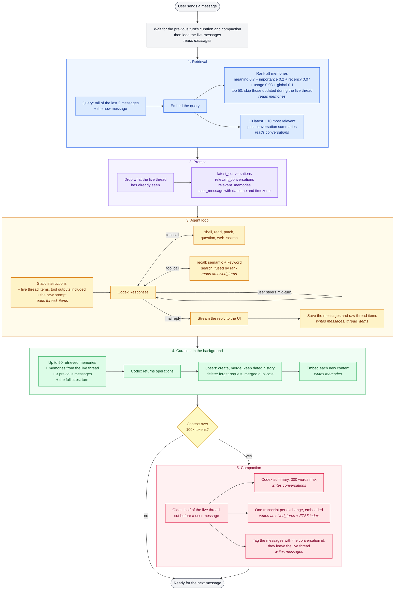

# How Memori works

One chat turn, from the user's message to compaction. Each step names the tables it reads or writes.

## Memory layers

| Layer                           | Table                      | Reaches the model                                         |
| ------------------------------- | -------------------------- | --------------------------------------------------------- |
| Durable facts                   | `memories`                 | Injected automatically when relevant and not already seen |
| Summaries of archived stretches | `conversations`            | Injected automatically, latest or relevant ones           |
| Archived exchanges              | `archived_turns`           | Only when the model calls `recall`                        |
| Full original history           | `messages`, `thread_items` | Live part replayed every turn, archived part never read   |
