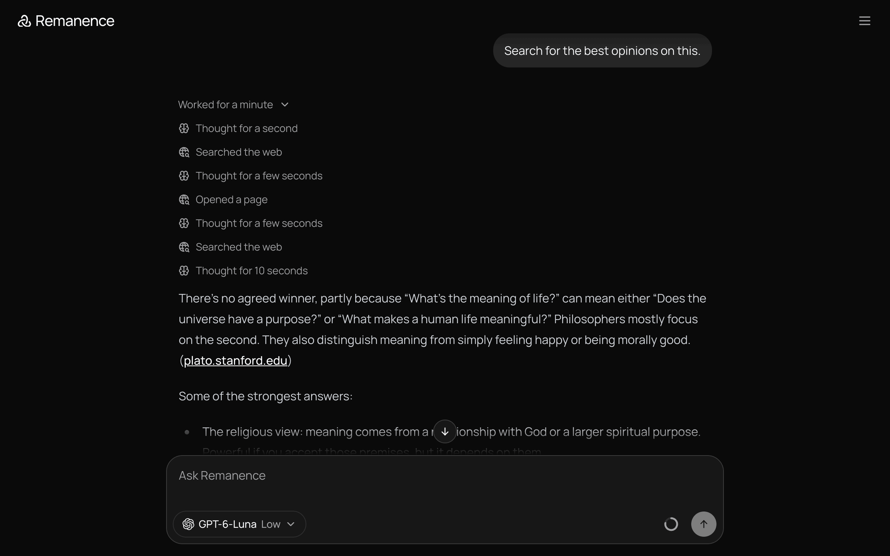

<p align="center">
  
</p>

<h1 align="center">Remanence</h1>

<p align="center">A personal AI agent with one chat that never resets.</p>

<p align="center">
  
</p>

Remanence remembers what matters about you and your work from one turn to the next, and can search everything that has left its context. It's also a research app for agent memory: the info icon under each reply opens the full trace of the turn, with the memories retrieved and their scores, the prompt sent to the model, the reasoning, and every memory change.

## How it remembers

- **Memories.** After each reply, a separate model call decides what to save, update, or forget. Each memory covers one subject, with absolute dates and a dated history when something changes.
- **Retrieval.** Each turn ranks every memory against the latest exchange and adds the top 50 the chat hasn't seen yet. The prompt prefix stays stable, so the prompt cache keeps working.
- **Compaction.** When the context passes 100k tokens, the oldest half of the chat is summarized into a past conversation. Recent and relevant summaries come back on later turns.
- **Recall.** Archived exchanges are indexed by embedding and by keyword, and the model searches them with the `recall` tool.

[`ARCHITECTURE.md`](ARCHITECTURE.md) shows the full flow of a turn.

## What the agent can do

The agent works on the machine running the server, your computer or a remote one. It can run commands in your `$SHELL`, read files, images, and PDFs, edit files, ask you to choose or confirm something, search the archive with `recall`, and search the web.

## Getting started

You need [Bun](https://bun.sh), Node 26, the [Codex CLI](https://github.com/openai/codex) logged in with ChatGPT, and an [OpenRouter](https://openrouter.ai) key for embeddings.

```sh
codex login
cp .env.example .env   # set OPENROUTER_API_KEY
bun install
bun run dev
```

<details>
<summary>More details</summary>

<br>

The server runs its own agent loop against the Codex Responses endpoint (`chatgpt.com/backend-api/codex/responses`), the same one the Codex CLI uses, with `store: false`. It reads the tokens from `~/.codex/auth.json` (or `$CODEX_HOME/auth.json`) and writes refreshed tokens back to it. The endpoint is undocumented, so an OpenAI change can break it.

The chat reply uses the model and reasoning effort picked in the composer. Curation and summaries use `gpt-6-luna` at `low`. Retrieval and ranking settings are in [`config.ts`](../src/features/memories/server/config.ts), and data lives in `.remanence/remanence.db`. `bun run check` formats, lints, and type checks.

</details>
